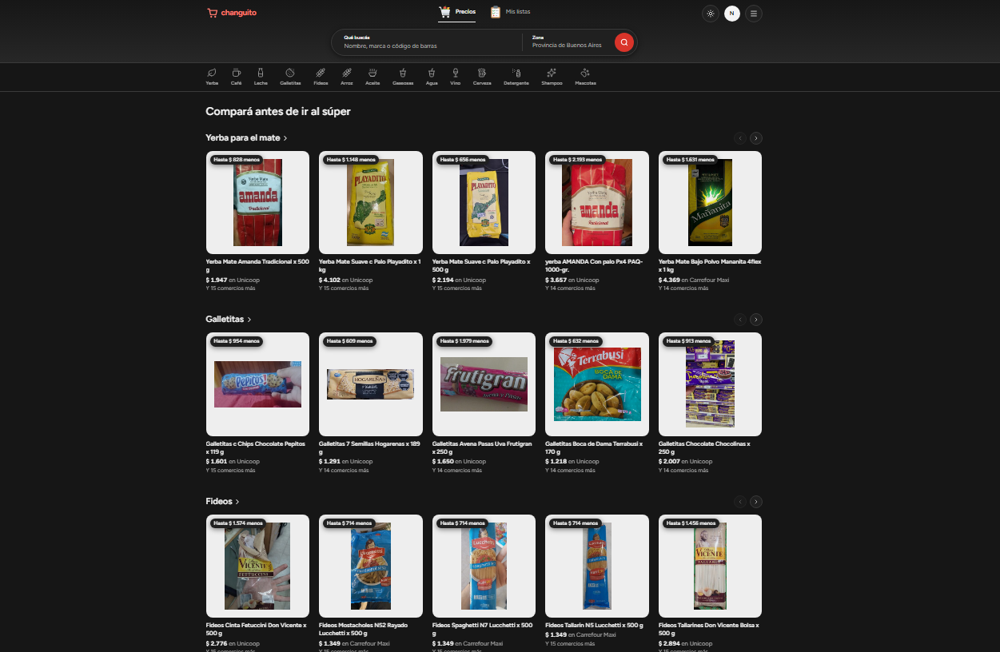
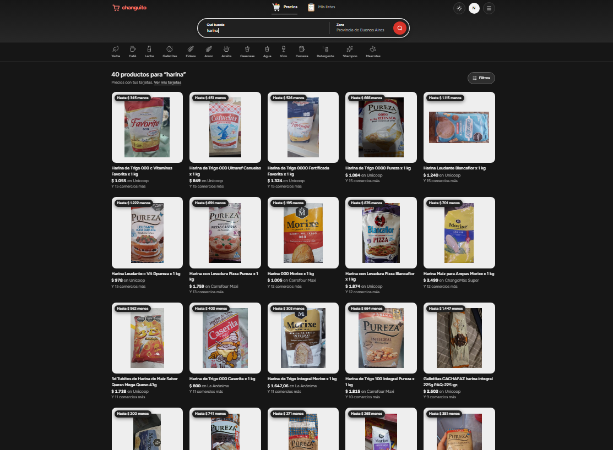

# Hi, I'm Nahuel Olima 👋

**Full Stack Developer & Product Builder** · TypeScript · React · Python · AI integration

I build and ship complete web products, from the data layer to the UI, using AI-assisted workflows backed by strict typing and automated tests. Since 2020 I've worked as a freelance graphic designer and video editor for content creators, and for the last two years I've been building my own products. That design work shapes how my apps look and feel.

- 🌎 Buenos Aires, Argentina · Open to remote roles (US / EU / LATAM)
- 📫 [LinkedIn](https://www.linkedin.com/in/nahu-olima-47257a327/) · [nahuolima98@gmail.com](mailto:nahuolima98@gmail.com)

## Featured projects

| Project | What it is | Highlights | Stack |
| :--- | :--- | :--- | :--- |
| **La Rosada** [Play](https://larosada.vercel.app) · [Code](https://github.com/bdarkin11/larosada) | Argentine political career simulator, from activist to president | ~13.5k lines of strict TypeScript with no frameworks, procedural sound with the Web Audio API, 212 Vitest tests plus Playwright E2E, Biome | TypeScript · Vite · Vitest · Playwright · Vercel |
| **Astrillón** [Play](https://astrillion.vercel.app) · [Code](https://github.com/bdarkin11/astrillon) | Daily word game: the rarer your answer, the farther your ship travels | Canvas 2D pixel-art scene, Vercel serverless API, Supabase with locked tables and key-protected functions, rate limiting, installable PWA, 136 Vitest tests | TypeScript · Canvas 2D · Supabase · Vercel · Vitest |
| **AhorrApp** *Private repo · in testing* | Supermarket price comparator for Buenos Aires Province, with shopping lists that find the cheapest store | ~66k products from 16 chains, updated daily from official SEPA price data; row-level security on every table, Zod validation, rate limiting, hCaptcha, encrypted daily backups; 21 loader tests and 263 database security tests | React · TypeScript · Tailwind · shadcn/ui · Zod · Supabase · Vercel |
| **LoL Stream Tools** [Code & demos](https://github.com/bdarkin11/lol-stream-tools) | Live overlays and automation for League of Legends streams | Riot API overlays for OBS, Twitch chat bot over EventSub, automatic Twitch clips on multikills via the Live Client Data API | Python · Riot API · Twitch API · OBS WebSocket |
| **Transcriptor Legal** [Code](https://github.com/bdarkin11/transcriptor-legal) | Legal audio transcription with AI | Gemini API transcription plus a shared Firestore dictionary that fixes misheard legal terms and learns new corrections | JavaScript · Gemini API · Firebase |

### AhorrApp in action

<table>
<tr>
<td></td>
<td></td>
</tr>
</table>

Prices come from Argentina's official SEPA dataset and refresh every day through GitHub Actions. Product photos come from [Open Food Facts](https://world.openfoodfacts.org) (open license, credited in the app). The code is private while the app is in testing; happy to walk through it on request.

Also: [twitch-lol-pick-bot](https://github.com/bdarkin11/twitch-lol-pick-bot), a Node.js Twitch bot that posts the champion, win rate and rank when a match starts.

## How I work

- **Type safety:** strict TypeScript in my web apps, with runtime validation at the edges.
- **Security by default:** secrets stay out of the repos, and in Astrillón the database is locked so it can only be reached through key-protected server functions.
- **Tests that let me move fast:** 340+ automated tests across my two games, plus end-to-end flows with Playwright.
- **Design eye:** years of graphic design and video editing for content creators guide how my products look and feel.

## Stack

- **Languages:** TypeScript · JavaScript · Python
- **Frontend:** React · Vite · Tailwind · shadcn/ui · Canvas 2D · Web Audio API
- **Backend & deploy:** Supabase (PostgreSQL) · Vercel serverless · Firebase / Firestore · Node.js
- **Testing & quality:** Vitest · Playwright · Biome · Zod
- **APIs:** Google Gemini · Riot Games · Twitch · OBS WebSocket

---

🇦🇷 *En español:* desarrollador full stack en Buenos Aires. Construyo productos web completos con TypeScript, React y Python, con flujos de trabajo asistidos por IA, tipado estricto y tests automatizados.
